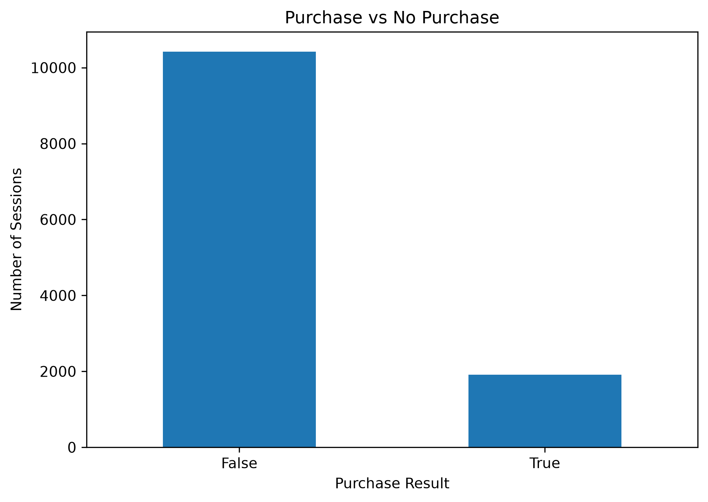
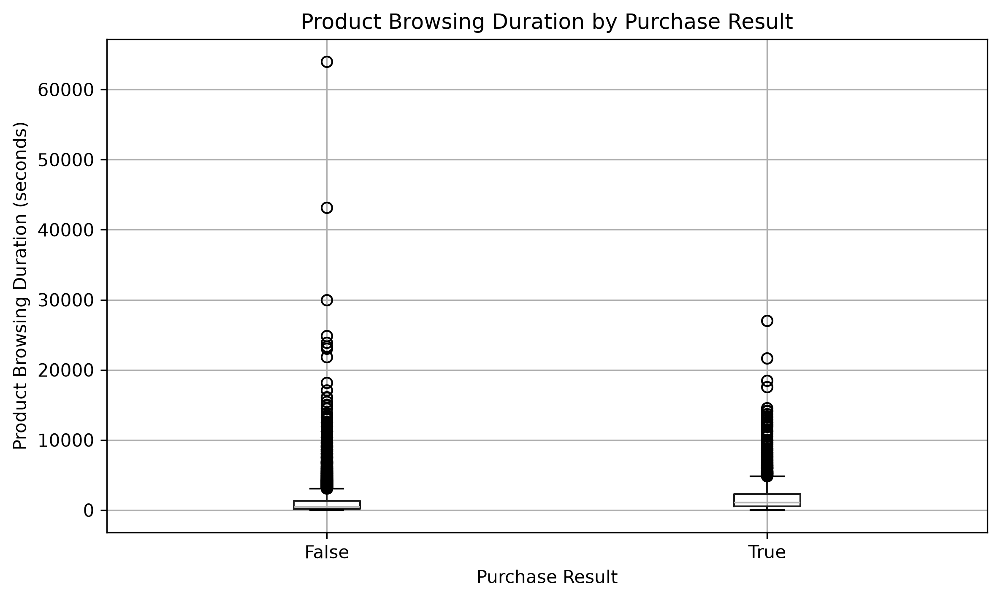
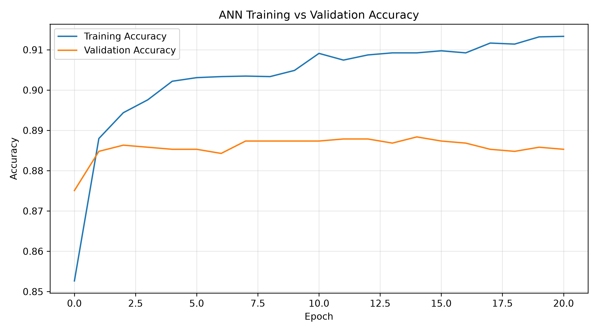
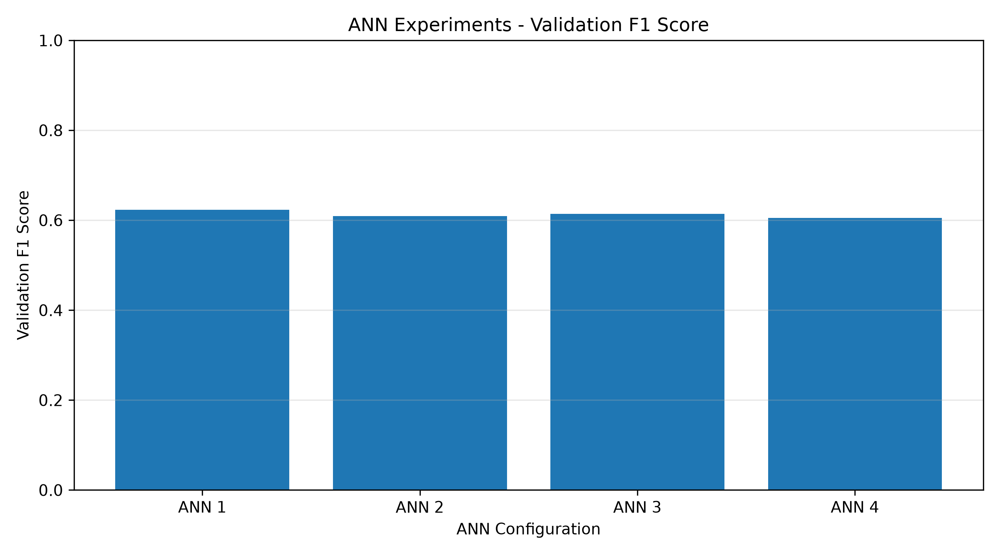
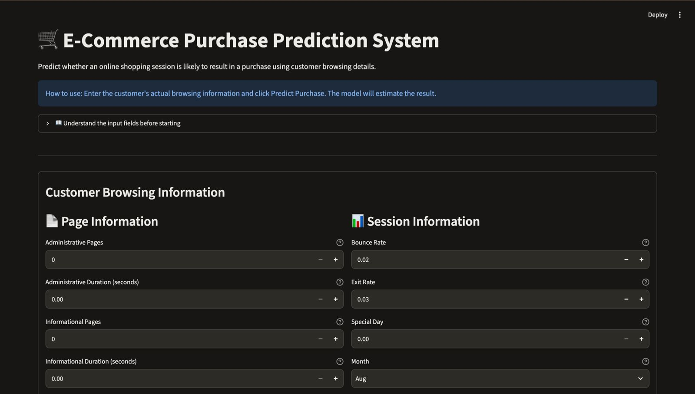
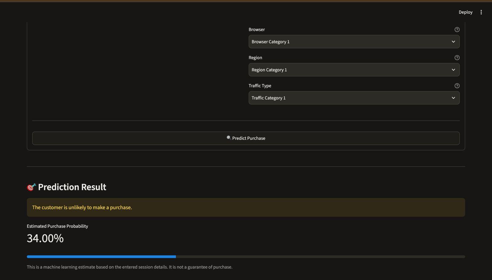

# 🛒 E-Commerce Purchase Prediction System

A Machine Learning and Deep Learning project that predicts whether an online shopping session will result in a purchase using customer browsing behaviour.

The project compares **Logistic Regression, K-Nearest Neighbors, Random Forest, and Artificial Neural Networks (ANN)** and includes an interactive Streamlit web application.

## 🚀 Live Demo

Try the deployed application here:

**[Open E-Commerce Purchase Prediction App](https://ecommerce-purchase-prediction-hh2lvreghmhfuqsnvafhm5.streamlit.app/)**

## 📌 Project Overview

The E-Commerce Purchase Prediction System predicts whether an e-commerce browsing session is likely to result in a purchase based on visitor activities.

The system analyzes customer session information, including:

- Number of pages visited.
- Time spent on product-related pages.
- Bounce rate and exit rate.
- Page values.
- Visitor type.
- Session and traffic information.

Three traditional machine learning algorithms and a TensorFlow/Keras Artificial Neural Network were trained and evaluated.

The **Random Forest classifier** was selected for deployment because of its strong purchase-class F1-score and recall.

An interactive web application was developed using Streamlit to demonstrate purchase predictions.

## 🎯 Project Objectives

- Analyze e-commerce customer browsing behaviour.
- Understand factors associated with purchasing decisions.
- Clean and preprocess the dataset.
- Perform exploratory data analysis.
- Generate meaningful data visualizations.
- Train and compare traditional machine learning models.
- Apply hyperparameter tuning and cross-validation.
- Analyze overfitting and underfitting.
- Develop an Artificial Neural Network using TensorFlow/Keras.
- Experiment with ANN architectures and training configurations.
- Evaluate models using classification metrics.
- Save trained models.
- Develop and deploy an interactive Streamlit application.

## 📊 Dataset

**Dataset Name:** Online Shoppers Purchasing Intention Dataset

**Source:** UCI Machine Learning Repository

[View Original Dataset](https://archive.ics.uci.edu/dataset/468/online+shoppers+purchasing+intention+dataset)

### Dataset Details

| Description | Value |
|---|---|
| Original records | 12,330 |
| Duplicate records removed | 125 |
| Cleaned records | 12,205 |
| Input features | 17 |
| Target variable | Revenue |
| File format | CSV |
| Project type | Binary Classification |

### Dataset Description

The dataset contains information about visitor browsing activities on an e-commerce website.

Each record represents an individual browsing session. The dataset includes numerical and categorical features describing page visits, browsing duration, visitor characteristics, and session information.

The dataset was obtained from the UCI Machine Learning Repository and processed using Python and Pandas.

### Input Features

| No. | Feature | Description |
|---|---|---|
| 1 | Administrative | Number of administrative pages visited during a session |
| 2 | Administrative_Duration | Time spent on administrative pages in seconds |
| 3 | Informational | Number of informational pages visited |
| 4 | Informational_Duration | Time spent on informational pages in seconds |
| 5 | ProductRelated | Number of product-related pages visited |
| 6 | ProductRelated_Duration | Time spent on product-related pages in seconds |
| 7 | BounceRates | Average bounce-rate metric for pages visited during the session |
| 8 | ExitRates | Average exit-rate metric for pages visited during the session |
| 9 | PageValues | Average value of visited pages in relation to completed transactions |
| 10 | SpecialDay | Closeness of the session date to a special shopping day |
| 11 | Month | Month in which the browsing session occurred |
| 12 | OperatingSystems | Encoded category representing the visitor's operating system |
| 13 | Browser | Encoded category representing the visitor's browser |
| 14 | Region | Encoded category representing the visitor's geographical region |
| 15 | TrafficType | Encoded category representing the source or type of website traffic |
| 16 | VisitorType | Visitor category: New Visitor, Returning Visitor, or Other |
| 17 | Weekend | Indicates whether the session occurred on a weekend |

The OperatingSystems, Browser, Region, and TrafficType features contain numerical category identifiers. These identifiers are treated as categorical variables rather than continuous numerical measurements.

### Target Variable

**Revenue** is the target variable used for prediction.

It contains two possible values:

- **True:** The browsing session resulted in a purchase.
- **False:** The browsing session did not result in a purchase.

The objective is to predict Revenue using the 17 input features.

### Label Generation Method

The target labels were provided in the original UCI dataset.

The Revenue variable indicates whether a transaction occurred during the recorded browsing session.

The project uses these existing labels for supervised machine learning. No artificial purchase labels were generated.

### Dataset Collection and Storage

Original dataset:

`dataset/online_shoppers_intention.csv`

Cleaned dataset:

`dataset/cleaned_online_shoppers.csv`

### Data Cleaning

The following steps were performed:

1. Loaded the dataset using Pandas.
2. Inspected the number of rows and columns.
3. Checked feature names and data types.
4. Checked for missing values.
5. Identified duplicate records.
6. Removed 125 duplicate records.
7. Saved the cleaned dataset in CSV format.

No missing values were found in the original dataset.

After cleaning, the dataset contained **12,205 records**.

## 🛠️ Technologies Used

### Programming and Data Analysis

- Python
- Pandas
- NumPy
- Matplotlib
- Seaborn

### Machine Learning

- Scikit-learn
- Logistic Regression
- K-Nearest Neighbors
- Random Forest
- RandomizedSearchCV
- StandardScaler
- OneHotEncoder

### Deep Learning

- TensorFlow 2.21.0
- Keras
- Artificial Neural Networks
- ReLU and Sigmoid activations
- Dropout
- Early Stopping
- Adam and RMSprop optimizers

### Application and Development

- Streamlit
- Joblib
- VS Code
- Git and GitHub
- Streamlit Community Cloud

## ⚙️ Project Workflow

1. **Data Collection:** Obtained the Online Shoppers Purchasing Intention Dataset from UCI.
2. **Data Exploration:** Inspected dataset structure, data types, and customer behaviour.
3. **Data Cleaning:** Checked for missing values and removed duplicate records.
4. **Feature Analysis:** Studied relationships between browsing activities and purchase outcomes.
5. **Data Preparation:** Applied numerical scaling, categorical encoding, and stratified data splitting.
6. **Traditional ML Training:** Trained Logistic Regression, KNN, and Random Forest.
7. **Model Evaluation:** Compared accuracy, precision, recall, F1-score, and confusion matrices.
8. **Hyperparameter Tuning:** Applied RandomizedSearchCV with 3-fold cross-validation.
9. **Overfitting Analysis:** Compared training, testing, and cross-validation performance.
10. **ANN Development:** Built an Artificial Neural Network using TensorFlow/Keras.
11. **ANN Experiments:** Tested different layers, neurons, batch sizes, and optimizers.
12. **ANN Evaluation:** Selected the best experimental architecture using validation F1-score and evaluated it on the held-out test set.
13. **Model Saving:** Saved trained Random Forest and ANN models.
14. **Web Application:** Developed an interactive prediction application using Streamlit.
15. **Deployment:** Deployed the Random Forest prediction application using Streamlit Community Cloud.

## 🔍 Data Preprocessing

### Numerical Features

The following numerical features were used:

- Administrative
- Administrative_Duration
- Informational
- Informational_Duration
- ProductRelated
- ProductRelated_Duration
- BounceRates
- ExitRates
- PageValues
- SpecialDay

Numerical features were scaled using StandardScaler where required.

### Categorical Features

The following categorical features were used:

- Month
- OperatingSystems
- Browser
- Region
- TrafficType
- VisitorType
- Weekend

Categorical features were transformed using OneHotEncoder.

### Training and Testing Split

The cleaned dataset was divided using stratified sampling:

| Dataset | Records | Percentage |
|---|---:|---:|
| Training | 9,764 | 80% |
| Testing | 2,441 | 20% |
| Total | 12,205 | 100% |

Stratified sampling maintained similar proportions of purchase and non-purchase sessions across the splits.

Preprocessing was fitted on training data to reduce data leakage.

### ANN Training, Validation, and Testing Split

For the ANN experiments, the original training portion was divided again to create a validation set.

| Dataset | Records |
|---|---:|
| ANN Training | 7,811 |
| ANN Validation | 1,953 |
| ANN Testing | 2,441 |
| Total | 12,205 |

The held-out test set was reserved for final evaluation.

The ANN preprocessing generated **74 input features** after numerical scaling and categorical encoding.

## 📈 Exploratory Data Analysis

Exploratory Data Analysis was performed to understand customer browsing behaviour and identify patterns related to purchasing decisions.

The analysis included:

- Distribution of purchase and non-purchase sessions.
- Comparison of purchasing behaviour across visitor types.
- Analysis of time spent on product-related pages.
- Correlation analysis of numerical features.
- Examination of PageValues and purchasing outcomes.

### Important Observations

#### 1. Class Imbalance

After cleaning:

- **No Purchase:** 10,297 sessions
- **Purchase:** 1,908 sessions

Non-purchase sessions significantly outnumber purchase sessions.

This makes precision, recall, and F1-score important evaluation metrics alongside accuracy.

#### 2. PageValues

Sessions resulting in purchases generally had higher PageValues.

Approximate average PageValues:

| Session Outcome | Average PageValues |
|---|---:|
| No Purchase | 2.00 |
| Purchase | 27.26 |

#### 3. Product-Related Duration

Sessions resulting in purchases generally involved more time spent on product-related pages.

| Session Outcome | Average Duration |
|---|---:|
| No Purchase | 1,082.98 seconds |
| Purchase | 1,876.21 seconds |

#### 4. Visitor Type

Purchase rates vary across visitor categories.

| Visitor Type | Purchase Percentage |
|---|---:|
| New Visitor | 24.93% |
| Returning Visitor | 14.09% |
| Other | 19.75% |

#### 5. Monthly Purchase Behaviour

Purchase rates vary across months.

- November: approximately 25.49%
- February: approximately 1.66%

These findings describe associations in the dataset and do not establish that a particular feature directly causes a purchase.

### EDA Visualizations

Five visualizations were generated using Matplotlib and Seaborn.

#### 1. Purchase Distribution



This bar chart compares the number of purchase and non-purchase sessions and highlights the class imbalance.

#### 2. Purchase Behavior by Visitor Type


This chart compares purchase and non-purchase session counts across visitor categories.

#### 3. Product Browsing Duration



This box plot compares time spent on product-related pages between purchase and non-purchase sessions.

#### 4. Feature Correlation Heatmap


This heatmap displays correlations between numerical features and helps identify relationships among browsing activities.

#### 5. Purchase Percentage by Visitor Type


This chart compares purchase percentages within each visitor category.

Unlike the visitor count chart, this visualization normalizes results by visitor type.

## 🤖 Traditional Machine Learning Models

Three traditional machine learning algorithms were trained and evaluated.

| Model | Test Accuracy | Purchase Precision | Purchase Recall | Purchase F1 |
|---|---:|---:|---:|---:|
| Logistic Regression | 88.69% | 0.75 | 0.41 | 0.53 |
| K-Nearest Neighbors | 87.34% | 0.66 | 0.39 | 0.49 |
| Random Forest | **89.59%** | 0.65 | **0.72** | **0.68** |

### Selected Traditional ML Model: Random Forest

Random Forest was selected because of its strong purchase-class recall and F1-score.

Baseline results:

- Accuracy: 89.59%
- Purchase Precision: 65%
- Purchase Recall: 72%
- Purchase F1-score: 68%

Class weighting was used to help address class imbalance.

## 🔧 Hyperparameter Tuning

RandomizedSearchCV was used to tune the Random Forest classifier.

The tuning process used:

- 3-fold cross-validation.
- F1-score as the optimization metric.
- Eight sampled hyperparameter configurations.

### Hyperparameters Explored

- `n_estimators`
- `max_depth`
- `min_samples_split`
- `min_samples_leaf`

### Best Hyperparameters

| Hyperparameter | Value |
|---|---:|
| n_estimators | 300 |
| max_depth | 30 |
| min_samples_split | 2 |
| min_samples_leaf | 1 |

Best cross-validation F1-score:

**0.6794**

### Baseline vs Tuned Random Forest

| Metric | Baseline Random Forest | Tuned Random Forest |
|---|---:|---:|
| Accuracy | **89.59%** | 89.43% |
| Purchase Precision | 65% | 65% |
| Purchase Recall | **72%** | 71% |
| Purchase F1-score | 68% | 68% |

The tuned model did not improve the test-set results.

Therefore, the original Random Forest model was retained for deployment.

## 📉 Random Forest Overfitting Analysis

The tuned Random Forest was evaluated using training, testing, and cross-validation metrics.

### Training vs Testing Performance

| Metric | Training | Testing |
|---|---:|---:|
| Accuracy | 0.9995 | 0.8943 |
| Precision | 0.9967 | 0.6483 |
| Recall | 1.0000 | 0.7094 |
| F1-score | 0.9984 | 0.6775 |

### Performance Gaps

| Measurement | Value |
|---|---:|
| Training vs Testing Accuracy Gap | 0.1052 |
| Training vs Testing F1 Gap | 0.3209 |
| Mean CV Training F1 | 0.9977 |
| Mean CV Validation F1 | 0.6794 |
| Cross-Validation F1 Gap | 0.3183 |

### Interpretation

The tuned Random Forest achieved almost perfect training performance but substantially lower testing and cross-validation F1-scores.

This indicates **significant overfitting**.

Although hyperparameter tuning identified a strong cross-validation configuration, it did not improve the final test performance compared with the baseline Random Forest.

### Overfitting Visualization


The chart compares training and testing performance and illustrates the generalization gap.

## 🧠 Artificial Neural Network (ANN)

An Artificial Neural Network was developed using TensorFlow and Keras to predict purchase outcomes.

The ANN was trained on the same cleaned dataset as the traditional machine learning models.

### ANN Architecture

The initial ANN used:

| Component | Configuration |
|---|---|
| Input Features | 74 |
| First Hidden Layer | 64 neurons |
| Second Hidden Layer | 32 neurons |
| Hidden Activation | ReLU |
| Output Layer | 1 neuron |
| Output Activation | Sigmoid |
| Dropout | 0.3 and 0.2 |
| Optimizer | Adam |
| Learning Rate | 0.001 |
| Loss Function | Binary Cross-Entropy |
| Batch Size | 32 |
| Maximum Epochs | 50 |
| Early Stopping Patience | 8 |
| Trainable Parameters | 6,913 |

### ANN Training

The initial ANN was trained using:

- 7,811 training records.
- 1,953 validation records.
- 2,441 held-out testing records.

Early stopping monitored validation loss and restored the best model weights.

Training stopped after **21 epochs**, with the best validation loss occurring at epoch 13.

### Initial ANN Test Results

| Metric | Result |
|---|---:|
| Accuracy | 89.80% |
| Precision (Purchase) | 0.6997 |
| Recall (Purchase) | 0.6099 |
| F1-score (Purchase) | 0.6517 |

### Initial ANN Confusion Matrix

| Actual / Predicted | No Purchase | Purchase |
|---|---:|---:|
| No Purchase | 1,959 | 100 |
| Purchase | 149 | 233 |

### ANN Training Visualizations

#### Training vs Validation Loss


Training loss decreased over time, while validation loss reached its minimum and later began increasing.

This suggests some overfitting during later epochs. Early stopping helped limit further overfitting.

#### Training vs Validation Accuracy



The graph compares training accuracy and validation accuracy across epochs.

It helps assess learning progress and generalization performance.

## 🧪 ANN Hyperparameter Experiments

Four ANN configurations were tested to study the effect of network architecture and training settings.

The experiments varied:

- Number of hidden layers.
- Number of neurons.
- Batch size.
- Optimizer.

Each configuration used a maximum of 40 epochs with early stopping.

The experimental models used ReLU hidden activations, sigmoid output activation, binary cross-entropy loss, and dropout of 0.2 after each hidden layer.

### ANN Experiment Configurations

| Model | Hidden Layers | Batch Size | Optimizer | Maximum Epochs |
|---|---|---:|---|---:|
| ANN 1 | 32 | 32 | Adam | 40 |
| ANN 2 | 64 → 32 | 32 | Adam | 40 |
| ANN 3 | 128 → 64 → 32 | 64 | Adam | 40 |
| ANN 4 | 64 → 32 | 64 | RMSprop | 40 |

### ANN Experiment Results

These results were measured on the **validation set**, not the test set.

| Model | Epochs Trained | Validation Accuracy | Precision | Recall | F1-score |
|---|---:|---:|---:|---:|---:|
| **ANN 1** | 28 | **0.8904** | **0.6730** | **0.5803** | **0.6232** |
| ANN 2 | 15 | 0.8884 | 0.6719 | 0.5574 | 0.6093 |
| ANN 3 | 13 | 0.8879 | 0.6641 | 0.5705 | 0.6138 |
| ANN 4 | 17 | 0.8879 | 0.6720 | 0.5508 | 0.6054 |

### Best ANN Experiment

**ANN 1** achieved the highest validation F1-score.

Its configuration was:

- One hidden layer.
- 32 neurons.
- Adam optimizer.
- Batch size of 32.
- Maximum of 40 epochs.
- Early stopping.
- 28 epochs trained.

Best validation F1-score:

**0.6232**

### ANN Experiment Comparison Visualization



This chart compares the validation F1-scores of the four experimental ANN configurations.

### Experiment Findings

The experiments showed that:

1. The simpler 32-neuron ANN achieved the highest validation F1-score.
2. Adding more layers and neurons did not improve validation F1-score.
3. Adam performed better than RMSprop in the tested configurations.
4. Early stopping reduced unnecessary training.
5. Larger networks were not automatically better for this dataset.

These conclusions apply to the configurations tested and do not establish that one optimizer or architecture is always superior.

## 🏆 Final Best ANN Evaluation

The best experimental ANN was evaluated on the held-out test set containing **2,441 records**.

The test set was not used to select the experimental architecture.

### Final Test Results

| Metric | Result |
|---|---:|
| Accuracy | **89.80%** |
| Precision (Purchase) | 0.6895 |
| Recall (Purchase) | 0.6335 |
| F1-score (Purchase) | **0.6603** |

### Final Classification Results

| Class | Precision | Recall | F1-score | Support |
|---|---:|---:|---:|---:|
| No Purchase | 0.93 | 0.95 | 0.94 | 2,059 |
| Purchase | 0.69 | 0.63 | 0.66 | 382 |

### Final ANN Confusion Matrix

| Actual / Predicted | No Purchase | Purchase |
|---|---:|---:|
| No Purchase | 1,950 | 109 |
| Purchase | 140 | 242 |

The best experimental ANN correctly identified 242 purchase sessions and 1,950 non-purchase sessions.

It missed 140 actual purchases and incorrectly classified 109 non-purchase sessions as purchases.

## 📊 Traditional ML vs Deep Learning Comparison

The final comparison includes three traditional machine learning algorithms and the ANN models.

| Model | Test Accuracy | Purchase F1-score |
|---|---:|---:|
| Logistic Regression | 88.69% | 0.53 |
| K-Nearest Neighbors | 87.34% | 0.49 |
| Random Forest (Baseline) | 89.59% | **0.68** |
| Random Forest (Tuned) | 89.43% | **0.68** |
| Initial ANN | **89.80%** | 0.6517 |
| Best Experimental ANN | **89.80%** | 0.6603 |

### Key Findings

**Highest Test Accuracy:** ANN — 89.80%

**Highest Purchase F1-score:** Random Forest — approximately 0.68

**Highest Purchase Recall:** Baseline Random Forest — approximately 0.72

**Best ANN Architecture Among Experiments:** One hidden layer with 32 neurons

### Final Model Selection

Although the ANN achieved slightly higher overall accuracy, Random Forest achieved better recall and F1-score for the purchase class.

Because the dataset is imbalanced, accuracy alone is not sufficient to determine the most useful classifier.

Therefore, the **baseline Random Forest remains the selected model for the Streamlit application**.

The ANN demonstrates that deep learning can achieve competitive results on the same dataset.

## 💾 Saved Models and Results

### Random Forest Model

`models/best_purchase_model.pkl`

The Random Forest model was saved using Joblib.

The saved object contains the preprocessing pipeline and trained classifier.

The model was loaded and tested to verify consistent predictions.

### Initial ANN Model

`models/ann_purchase_model.keras`

The initial ANN was saved using the native Keras model format.

### Best Experimental ANN

`models/ann_best_experiment.keras`

The best experimental ANN was selected using validation F1-score.

### ANN Experiment Results

`models/ann_experiment_results.csv`

This CSV file contains the experiment configurations and validation metrics.


### ANN Preprocessing

The fitted ANN preprocessing pipeline is saved as:

`models/ann_preprocessor.pkl`

It contains the numerical scaling and categorical encoding transformations fitted on the ANN training data.

The final evaluation script loads this saved preprocessor alongside `models/ann_best_experiment.keras`, ensuring consistent feature transformations.

The saved ANN and preprocessor were successfully verified on the held-out test set of 2,441 records, reproducing an accuracy of 89.80% and a purchase-class F1-score of 0.6603.

## 🌐 Streamlit Web Application

The project includes an interactive web application where users can enter shopping session details and receive a purchase prediction.

### Application Features

- User-friendly interface.
- Input fields for customer browsing activities.
- Numerical and categorical input options.
- Helpful descriptions for input fields.
- Purchase prediction.
- Estimated purchase probability.
- Interactive prediction results.

### Application Screenshots

#### 1. Application Home Page



#### 2. Prediction Result



### Live Application

**[Try the E-Commerce Purchase Prediction App](https://ecommerce-purchase-prediction-hh2lvreghmhfuqsnvafhm5.streamlit.app/)**

## 📁 Project Structure

```text
Ecommerce-Purchase-Prediction/
│
├── dataset/
│   ├── online_shoppers_intention.csv
│   └── cleaned_online_shoppers.csv
│
├── models/
│   ├── best_purchase_model.pkl
│   ├── ann_purchase_model.keras
│   ├── ann_best_experiment.keras
│   └── ann_experiment_results.csv
│
├── screenshots/
│   ├── app-home.png
│   └── prediction-result.png
│
├── visualizations/
│   ├── purchase_distribution.png
│   ├── visitor_purchase_behavior.png
│   ├── product_browsing_duration.png
│   ├── feature_correlation_heatmap.png
│   ├── visitor_purchase_percentage.png
│   ├── random_forest_overfitting_analysis.png
│   ├── ann_training_loss.png
│   ├── ann_training_accuracy.png
│   └── ann_experiment_comparison.png
│
├── data_exploration.py
├── data_cleaning.py
├── feature_analysis.py
├── data_preparation.py
├── model_preprocessing.py
├── logistic_regression.py
├── knn_model.py
├── random_forest.py
├── random_forest_tuning.py
├── save_best_model.py
├── test_saved_model.py
├── inspect_app_inputs.py
│
├── ann_model.py
├── ann_experiments.py
├── ann_final_evaluation.py
│
├── app.py
├── requirements.txt
├── README.md
└── .gitignore
```

## 💻 How to Run the Project Locally

### Step 1: Clone the Repository

```bash
git clone https://github.com/farzinmansoor/Ecommerce-Purchase-Prediction.git
```

### Step 2: Navigate to the Project Folder

```bash
cd Ecommerce-Purchase-Prediction
```

### Step 3: Create a Virtual Environment

```bash
python3 -m venv .venv
```

### Step 4: Activate the Virtual Environment

For macOS and Linux:

```bash
source .venv/bin/activate
```

### Step 5: Install Required Libraries

```bash
pip install -r requirements.txt
```

### Step 6: Run the Streamlit Application

```bash
streamlit run app.py
```

The application will open in your web browser.

## 🧠 Running the ANN Locally

TensorFlow training was performed separately using Python 3.12.

This avoids changing the existing Streamlit application environment.

### Step 1: Create an ANN Virtual Environment

Make sure Python 3.12 is installed.

```bash
python3.12 -m venv .venv-ann
```

### Step 2: Activate the ANN Environment

```bash
source .venv-ann/bin/activate
```

### Step 3: Install ANN Dependencies

```bash
python -m pip install tensorflow==2.21.0 numpy pandas matplotlib scikit-learn
```

### Step 4: Train the Initial ANN

```bash
python ann_model.py
```

### Step 5: Run ANN Experiments

```bash
python ann_experiments.py
```

### Step 6: Evaluate the Best Experimental ANN

```bash
python ann_final_evaluation.py
```

The scripts generate trained ANN models, experiment results, and training visualizations.

The ANN environment is excluded from Git using `.gitignore`.

## ⚠️ Limitations and Responsible Use

- The models were trained on a specific historical e-commerce dataset and may not generalize to every online store.
- The dataset contains substantially more non-purchase sessions than purchase sessions.
- Some models may achieve high accuracy while missing actual purchase sessions.
- The tuned Random Forest showed significant overfitting.
- ANN performance depends on architecture, training configuration, and the selected decision threshold.
- The ANN experiments covered four configurations rather than an exhaustive hyperparameter search.
- The ANN uses a default classification threshold of 0.5.
- The application does not automatically collect live website visitor data.
- Purchase probabilities are model estimates and do not guarantee an actual purchase.
- The project is intended for educational and demonstration purposes.

## 🔮 Future Improvements

Possible improvements include:

- Experimenting with class weights and alternative loss functions for ANN training.
- Tuning the classification threshold using validation data.
- Evaluating additional neural network architectures.
- Saving ANN preprocessing for standalone inference.
- Adding probability calibration and further model diagnostics.
- Testing performance on more recent e-commerce data.
- Extending the Streamlit application to compare predictions from multiple models.

## 📚 References

Sakar, C. O., & Kastro, Y. (2018). Online Shoppers Purchasing Intention Dataset. UCI Machine Learning Repository.

Dataset License: CC BY 4.0.

[UCI Machine Learning Repository](https://archive.ics.uci.edu/dataset/468/online+shoppers+purchasing+intention+dataset)

[TensorFlow Documentation](https://www.tensorflow.org/)

[Scikit-learn Documentation](https://scikit-learn.org/stable/)

[Streamlit Documentation](https://docs.streamlit.io/)

## 👨‍💻 Author

**Farzin Mansoor**

- GitHub: https://github.com/farzinmansoor
- LinkedIn: https://www.linkedin.com/in/farzin-mansoor-8045b3361/

---

⭐ If you find this project interesting, feel free to explore the repository and try the live application!
