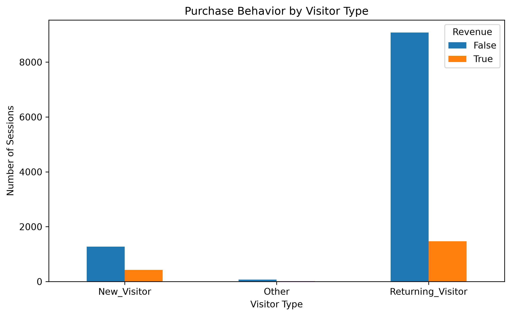
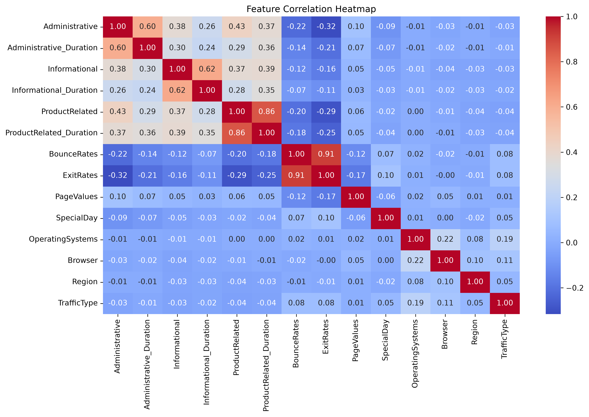
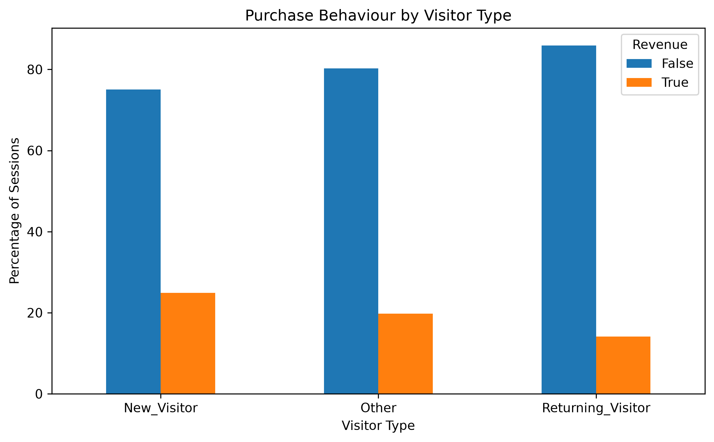
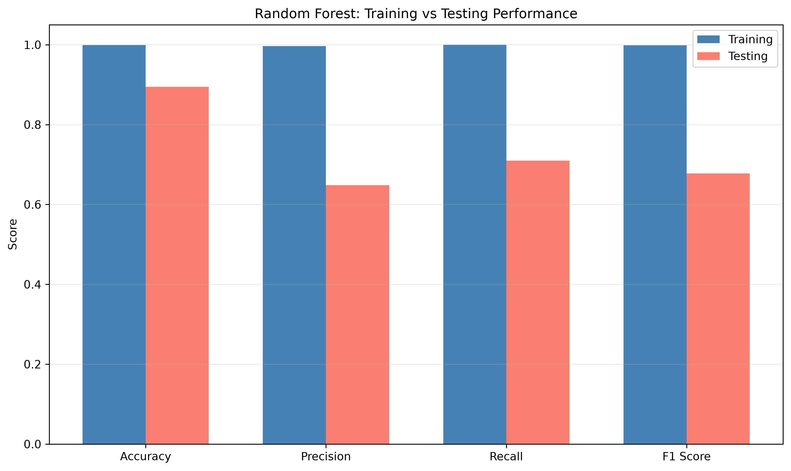
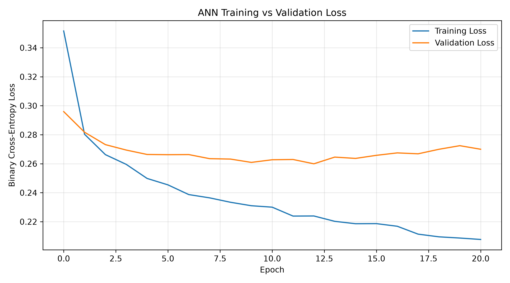
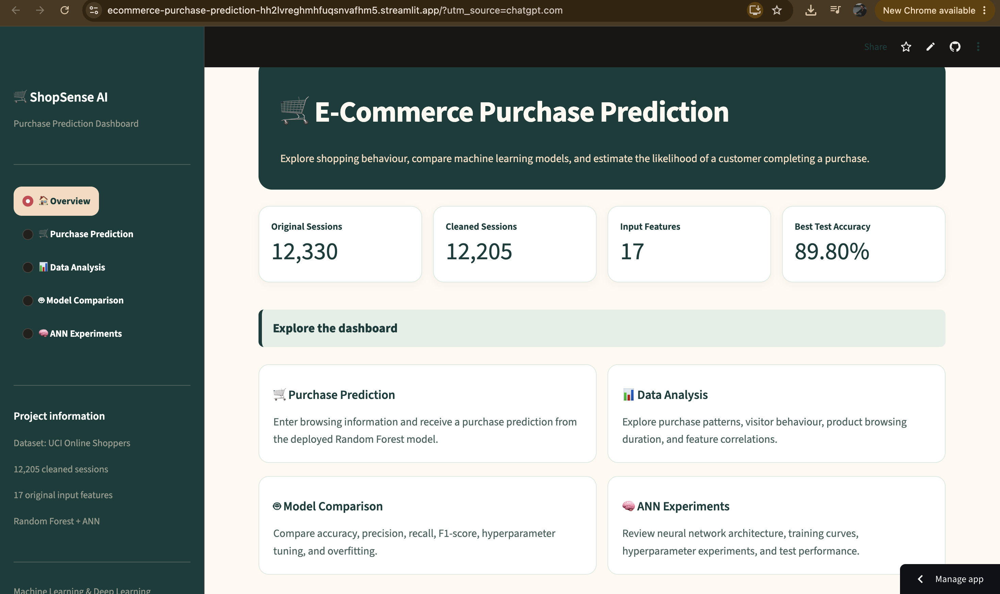
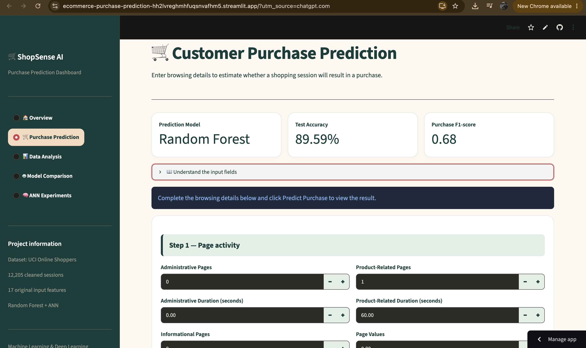
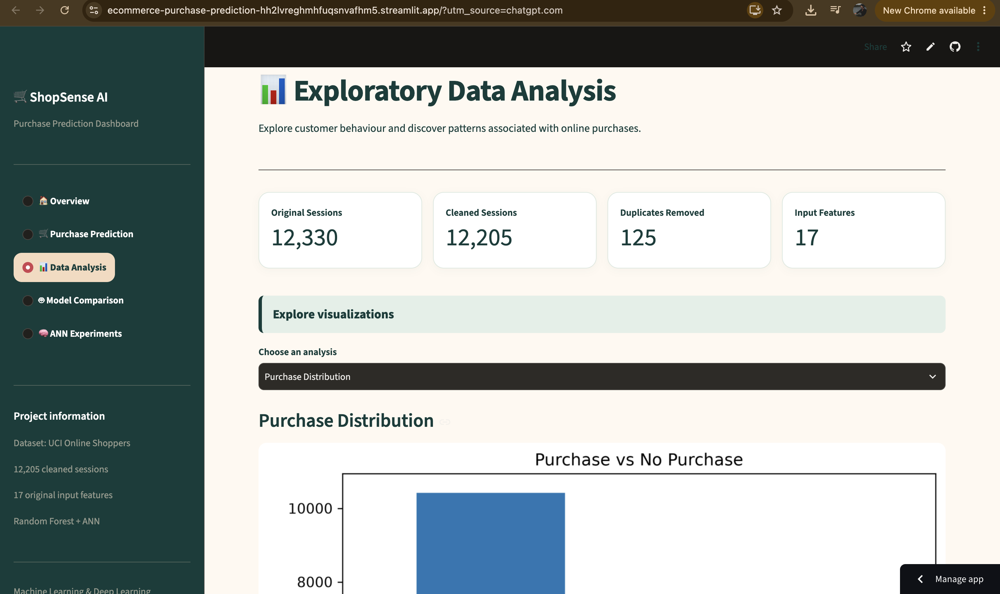
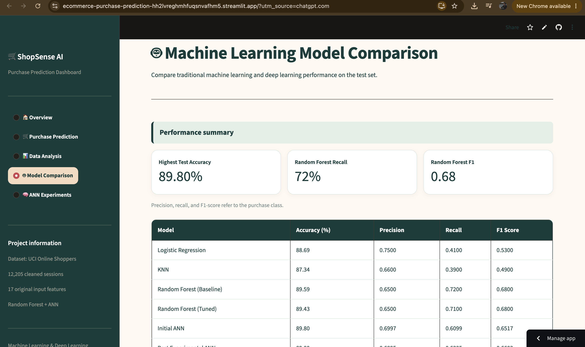
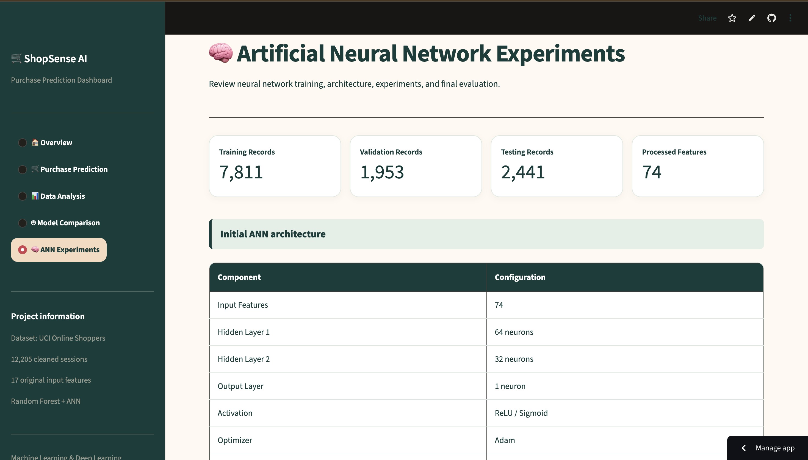

# 🛒 ShopSense AI — E-Commerce Purchase Prediction System

### Machine Learning & Deep Learning | Customer Purchase Prediction

A complete Machine Learning and Deep Learning project that predicts whether an online shopping session will result in a purchase based on customer browsing behaviour.

The project compares **Logistic Regression, K-Nearest Neighbors, Random Forest, and Artificial Neural Networks (ANN)** and includes an interactive **Streamlit web application** with a green-and-cream dashboard.

The application provides purchase predictions, exploratory data analysis, model comparisons, and ANN experiment results.

## 🚀 Live Demo

**[Open ShopSense AI — Live Application](https://ecommerce-purchase-prediction-hh2lvreghmhfuqsnvafhm5.streamlit.app/)**

Explore the deployed dashboard and predict whether a customer browsing session is likely to result in a purchase.

---

## 📌 Project Overview

ShopSense AI analyzes e-commerce browsing sessions to predict purchasing intentions using supervised machine learning.

The system examines customer behaviour, including:

- Number of pages visited
- Time spent on product-related pages
- Bounce rates and exit rates
- Page values
- Visitor type
- Month and weekend information
- Operating system, browser, region, and traffic type

Three traditional machine learning algorithms and a TensorFlow/Keras Artificial Neural Network were trained and evaluated.

The **baseline Random Forest classifier** was selected for deployment because it achieved strong purchase-class recall and F1-score.

Although the ANN achieved slightly higher overall accuracy, Random Forest performed better at identifying actual purchase sessions.

### Project Highlights

| Component | Details |
|---|---|
| Project Name | ShopSense AI |
| Dataset | UCI Online Shoppers Purchasing Intention |
| Original Sessions | 12,330 |
| Cleaned Sessions | 12,205 |
| Original Input Features | 17 |
| ANN Input Features After Preprocessing | 74 |
| Target Variable | Revenue |
| Problem Type | Binary Classification |
| ML Algorithms | Logistic Regression, KNN, Random Forest |
| Deep Learning | Artificial Neural Network |
| Deployed Model | Baseline Random Forest |
| Web Framework | Streamlit |
| Deployment | Streamlit Community Cloud |

---

## 🎯 Project Objectives

The main objectives of this project are:

1. Analyze e-commerce customer browsing behaviour.
2. Understand factors associated with purchasing decisions.
3. Clean and preprocess the dataset.
4. Perform exploratory data analysis.
5. Generate meaningful visualizations.
6. Train and compare traditional machine learning models.
7. Apply hyperparameter tuning and cross-validation.
8. Analyze model overfitting and underfitting.
9. Develop an Artificial Neural Network using TensorFlow/Keras.
10. Experiment with different ANN architectures and training configurations.
11. Evaluate models using accuracy, precision, recall, and F1-score.
12. Save and verify trained models.
13. Build an interactive Streamlit dashboard.
14. Deploy the prediction application online.

---

## 📊 Dataset

**Dataset Name:** Online Shoppers Purchasing Intention Dataset

**Source:** UCI Machine Learning Repository

**[View Original Dataset](https://archive.ics.uci.edu/dataset/468/online+shoppers+purchasing+intention+dataset)**

### Dataset Details

| Description | Value |
|---|---|
| Original Records | 12,330 |
| Duplicate Records Removed | 125 |
| Cleaned Records | 12,205 |
| Input Features | 17 |
| Target Variable | Revenue |
| File Format | CSV |
| Project Type | Binary Classification |

### Dataset Description

The dataset contains information about visitor browsing activities on an e-commerce website.

Each record represents a browsing session and includes numerical and categorical features describing page visits, browsing duration, visitor characteristics, and session information.

The dataset was obtained from the UCI Machine Learning Repository and processed using Python and Pandas.

### Input Features

| No. | Feature | Description |
|---|---|---|
| 1 | Administrative | Number of administrative pages visited |
| 2 | Administrative_Duration | Time spent on administrative pages |
| 3 | Informational | Number of informational pages visited |
| 4 | Informational_Duration | Time spent on informational pages |
| 5 | ProductRelated | Number of product-related pages visited |
| 6 | ProductRelated_Duration | Time spent on product-related pages |
| 7 | BounceRates | Average bounce-rate metric |
| 8 | ExitRates | Average exit-rate metric |
| 9 | PageValues | Average value of visited pages in relation to transactions |
| 10 | SpecialDay | Closeness to a special shopping day |
| 11 | Month | Month of the browsing session |
| 12 | OperatingSystems | Operating system category |
| 13 | Browser | Browser category |
| 14 | Region | Geographical region category |
| 15 | TrafficType | Website traffic source category |
| 16 | VisitorType | New, Returning, or Other visitor |
| 17 | Weekend | Whether the session occurred on a weekend |

OperatingSystems, Browser, Region, and TrafficType contain numerical category identifiers. These are treated as categorical variables rather than continuous measurements.

### Target Variable

The target variable is **Revenue**.

- **True:** The browsing session resulted in a purchase.
- **False:** The browsing session did not result in a purchase.

The objective is to predict Revenue using the 17 original input features.

### Label Generation

The target labels were provided in the original UCI dataset.

No artificial purchase labels were generated.

### Dataset Storage

Original dataset:

`dataset/online_shoppers_intention.csv`

Cleaned dataset:

`dataset/cleaned_online_shoppers.csv`

### Data Cleaning

The following steps were performed:

1. Loaded the dataset using Pandas.
2. Inspected the number of rows and columns.
3. Checked feature names and data types.
4. Checked for missing values.
5. Identified duplicate records.
6. Removed 125 duplicate records.
7. Saved the cleaned dataset.

No missing values were found in the original dataset.

After cleaning, the dataset contained **12,205 records**.

---

## 🛠️ Technologies Used

### Programming and Data Analysis

- Python
- Pandas
- NumPy
- Matplotlib
- Seaborn

### Machine Learning

- Scikit-learn
- Logistic Regression
- K-Nearest Neighbors
- Random Forest
- RandomizedSearchCV
- StandardScaler
- OneHotEncoder

### Deep Learning

- TensorFlow 2.21.0
- Keras
- Artificial Neural Networks
- ReLU and Sigmoid activations
- Dropout
- Early Stopping
- Adam and RMSprop optimizers

### Application and Development

- Streamlit
- Joblib
- Visual Studio Code
- Git and GitHub
- Streamlit Community Cloud

---

## ⚙️ Project Workflow

The project follows a structured machine learning and deep learning workflow.

1. **Data Collection:** Obtained the Online Shoppers Purchasing Intention Dataset from UCI.
2. **Data Exploration:** Inspected dataset structure, feature types, and browsing behaviour.
3. **Data Cleaning:** Checked for missing values and removed duplicates.
4. **Feature Analysis:** Examined relationships between browsing activities and purchase outcomes.
5. **Data Preparation:** Applied numerical scaling, categorical encoding, and stratified splitting.
6. **Traditional ML Training:** Trained Logistic Regression, KNN, and Random Forest.
7. **Model Evaluation:** Compared accuracy, precision, recall, F1-score, and confusion matrices.
8. **Hyperparameter Tuning:** Applied RandomizedSearchCV with 3-fold cross-validation.
9. **Overfitting Analysis:** Compared training, testing, and cross-validation performance.
10. **ANN Development:** Built a neural network using TensorFlow/Keras.
11. **ANN Experiments:** Tested different architectures, batch sizes, and optimizers.
12. **ANN Evaluation:** Selected the best experimental configuration using validation F1-score.
13. **Model Saving:** Saved the Random Forest and ANN models.
14. **Application Development:** Built the ShopSense AI Streamlit dashboard.
15. **Deployment:** Deployed the Random Forest prediction application using Streamlit Community Cloud.

---

## 🔍 Data Preprocessing

### Numerical Features

The following numerical features were used:

- Administrative
- Administrative_Duration
- Informational
- Informational_Duration
- ProductRelated
- ProductRelated_Duration
- BounceRates
- ExitRates
- PageValues
- SpecialDay

Numerical features were scaled using StandardScaler where required.

### Categorical Features

The following categorical features were used:

- Month
- OperatingSystems
- Browser
- Region
- TrafficType
- VisitorType
- Weekend

Categorical features were transformed using OneHotEncoder.

### Training and Testing Split

The cleaned dataset was divided using stratified sampling.

| Dataset | Records | Percentage |
|---|---:|---:|
| Training | 9,764 | 80% |
| Testing | 2,441 | 20% |
| Total | 12,205 | 100% |

Stratified sampling maintained similar proportions of purchase and non-purchase sessions.

Preprocessing was fitted on training data to reduce data leakage.

### ANN Training, Validation, and Testing Split

The original training portion was divided again to create a validation set for ANN experiments.

| Dataset | Records |
|---|---:|
| ANN Training | 7,811 |
| ANN Validation | 1,953 |
| ANN Testing | 2,441 |
| Total | 12,205 |

The held-out test set was reserved for final evaluation.

After numerical scaling and categorical encoding, the ANN used **74 input features**.

---

## 📈 Exploratory Data Analysis

Exploratory Data Analysis was performed to understand customer browsing behaviour and identify patterns related to purchasing decisions.

The analysis included:

- Distribution of purchase and non-purchase sessions
- Purchasing behaviour across visitor types
- Time spent on product-related pages
- Correlation analysis of numerical features
- PageValues and purchasing outcomes
- Monthly purchasing behaviour

### 1. Class Imbalance

After cleaning:

| Session Outcome | Records |
|---|---:|
| No Purchase | 10,297 |
| Purchase | 1,908 |
| Total | 12,205 |

Non-purchase sessions significantly outnumber purchase sessions.

Therefore, precision, recall, and F1-score are important evaluation metrics alongside accuracy.

### 2. PageValues

Sessions resulting in purchases generally had higher PageValues.

| Session Outcome | Average PageValues |
|---|---:|
| No Purchase | 2.00 |
| Purchase | 27.26 |

### 3. Product-Related Duration

Sessions resulting in purchases generally involved more time spent on product-related pages.

| Session Outcome | Average Duration |
|---|---:|
| No Purchase | 1,082.98 seconds |
| Purchase | 1,876.21 seconds |

### 4. Visitor Type

Purchase rates vary across visitor categories.

| Visitor Type | Purchase Percentage |
|---|---:|
| New Visitor | 24.93% |
| Returning Visitor | 14.09% |
| Other | 19.75% |

### 5. Monthly Purchase Behaviour

Purchase rates vary across months.

Examples:

- November: approximately 25.49%
- February: approximately 1.66%

These findings describe associations in the dataset and do not establish that any particular feature directly causes a purchase.

### EDA Visualizations

#### Purchase Distribution


This visualization compares purchase and non-purchase sessions and highlights class imbalance.

#### Purchase Behaviour by Visitor Type



This chart compares purchase and non-purchase session counts across visitor categories.

#### Product Browsing Duration


This box plot compares time spent on product-related pages between purchase and non-purchase sessions.

#### Feature Correlation Heatmap



This heatmap displays correlations between numerical features.

#### Purchase Percentage by Visitor Type



This visualization compares purchase percentages within each visitor category.

---

## 🤖 Traditional Machine Learning Models

Three traditional machine learning algorithms were trained and evaluated.

| Model | Test Accuracy | Purchase Precision | Purchase Recall | Purchase F1 |
|---|---:|---:|---:|---:|
| Logistic Regression | 88.69% | 0.75 | 0.41 | 0.53 |
| K-Nearest Neighbors | 87.34% | 0.66 | 0.39 | 0.49 |
| **Random Forest** | **89.59%** | 0.65 | **0.72** | **0.68** |

### Selected Traditional ML Model: Random Forest

Random Forest was selected because of its strong purchase-class recall and F1-score.

Baseline results:

- **Accuracy:** 89.59%
- **Purchase Precision:** 65%
- **Purchase Recall:** 72%
- **Purchase F1-score:** 68%

Class weighting was used to help address class imbalance.

---

## 🔧 Hyperparameter Tuning

RandomizedSearchCV was used to tune the Random Forest classifier.

The tuning process used:

- 3-fold cross-validation
- F1-score as the optimization metric
- Eight sampled hyperparameter configurations

### Hyperparameters Explored

- `n_estimators`
- `max_depth`
- `min_samples_split`
- `min_samples_leaf`

### Best Hyperparameters

| Hyperparameter | Value |
|---|---:|
| n_estimators | 300 |
| max_depth | 30 |
| min_samples_split | 2 |
| min_samples_leaf | 1 |

**Best Cross-Validation F1-score:** 0.6794

### Baseline vs Tuned Random Forest

| Metric | Baseline Random Forest | Tuned Random Forest |
|---|---:|---:|
| Accuracy | **89.59%** | 89.43% |
| Purchase Precision | 65% | 65% |
| Purchase Recall | **72%** | 71% |
| Purchase F1-score | 68% | 68% |

The tuned model did not improve the test-set results.

Therefore, the original Random Forest model was retained for deployment.

---

## 📉 Random Forest Overfitting Analysis

The tuned Random Forest was evaluated using training, testing, and cross-validation metrics.

### Training vs Testing Performance

| Metric | Training | Testing |
|---|---:|---:|
| Accuracy | 0.9995 | 0.8943 |
| Precision | 0.9967 | 0.6483 |
| Recall | 1.0000 | 0.7094 |
| F1-score | 0.9984 | 0.6775 |

### Performance Gaps

| Measurement | Value |
|---|---:|
| Training vs Testing Accuracy Gap | 0.1052 |
| Training vs Testing F1 Gap | 0.3209 |
| Mean CV Training F1 | 0.9977 |
| Mean CV Validation F1 | 0.6794 |
| Cross-Validation F1 Gap | 0.3183 |

### Interpretation

The tuned Random Forest achieved almost perfect training performance but substantially lower testing and cross-validation F1-scores.

This indicates **significant overfitting**.

Although hyperparameter tuning identified a strong cross-validation configuration, it did not improve final test performance compared with the baseline Random Forest.

### Overfitting Visualization



The chart compares training and testing performance and illustrates the generalization gap.

---

## 🧠 Artificial Neural Network (ANN)

An Artificial Neural Network was developed using TensorFlow and Keras to predict purchase outcomes.

The ANN was trained on the same cleaned dataset as the traditional machine learning models.

### Initial ANN Architecture

| Component | Configuration |
|---|---|
| Input Features | 74 |
| First Hidden Layer | 64 neurons |
| Second Hidden Layer | 32 neurons |
| Hidden Activation | ReLU |
| Output Layer | 1 neuron |
| Output Activation | Sigmoid |
| Dropout | 0.3 and 0.2 |
| Optimizer | Adam |
| Learning Rate | 0.001 |
| Loss Function | Binary Cross-Entropy |
| Batch Size | 32 |
| Maximum Epochs | 50 |
| Early Stopping Patience | 8 |
| Trainable Parameters | 6,913 |

### ANN Training

The initial ANN used:

- 7,811 training records
- 1,953 validation records
- 2,441 held-out testing records

Early stopping monitored validation loss and restored the best model weights.

Training stopped after **21 epochs**, with the best validation loss occurring at epoch 13.

### Initial ANN Test Results

| Metric | Result |
|---|---:|
| Accuracy | 89.80% |
| Precision (Purchase) | 0.6997 |
| Recall (Purchase) | 0.6099 |
| F1-score (Purchase) | 0.6517 |

### Initial ANN Confusion Matrix

| Actual / Predicted | No Purchase | Purchase |
|---|---:|---:|
| No Purchase | 1,959 | 100 |
| Purchase | 149 | 233 |

### ANN Training Visualizations

#### Training vs Validation Loss



Training loss decreased over time, while validation loss reached its minimum and later began increasing.

This suggests some overfitting during later epochs. Early stopping helped limit further overfitting.

#### Training vs Validation Accuracy


This graph compares training and validation accuracy across epochs.

It helps assess learning progress and generalization performance.

---

## 🧪 ANN Hyperparameter Experiments

Four ANN configurations were tested to study the effects of architecture and training settings.

The experiments varied:

- Number of hidden layers
- Number of neurons
- Batch size
- Optimizer

Each configuration used a maximum of 40 epochs with early stopping.

The experimental models used ReLU hidden activations, sigmoid output activation, binary cross-entropy loss, and dropout of 0.2 after each hidden layer.

### ANN Experiment Configurations

| Model | Hidden Layers | Batch Size | Optimizer | Maximum Epochs |
|---|---|---:|---|---:|
| ANN 1 | 32 | 32 | Adam | 40 |
| ANN 2 | 64 → 32 | 32 | Adam | 40 |
| ANN 3 | 128 → 64 → 32 | 64 | Adam | 40 |
| ANN 4 | 64 → 32 | 64 | RMSprop | 40 |

### ANN Experiment Results

These results were measured on the **validation set**, not the test set.

| Model | Epochs Trained | Validation Accuracy | Precision | Recall | F1-score |
|---|---:|---:|---:|---:|---:|
| **ANN 1** | 28 | **0.8904** | **0.6730** | **0.5803** | **0.6232** |
| ANN 2 | 15 | 0.8884 | 0.6719 | 0.5574 | 0.6093 |
| ANN 3 | 13 | 0.8879 | 0.6641 | 0.5705 | 0.6138 |
| ANN 4 | 17 | 0.8879 | 0.6720 | 0.5508 | 0.6054 |

### Best ANN Experiment

**ANN 1** achieved the highest validation F1-score.

Its configuration was:

- One hidden layer
- 32 neurons
- Adam optimizer
- Batch size of 32
- Maximum of 40 epochs
- Early stopping
- 28 epochs trained

**Best Validation F1-score:** 0.6232

### ANN Experiment Comparison Visualization


This chart compares validation F1-scores across the four ANN configurations.

### Experiment Findings

1. The simpler 32-neuron ANN achieved the highest validation F1-score.
2. Adding more layers and neurons did not improve validation F1-score.
3. Adam performed better than RMSprop in the tested configurations.
4. Early stopping reduced unnecessary training.
5. Larger networks were not automatically better for this dataset.

These conclusions apply to the tested configurations and do not establish that one optimizer or architecture is always superior.

---

## 🏆 Final Best ANN Evaluation

The best experimental ANN was evaluated on the held-out test set containing **2,441 records**.

The test set was not used to select the experimental architecture.

### Final Test Results

| Metric | Result |
|---|---:|
| Accuracy | **89.80%** |
| Precision (Purchase) | 0.6895 |
| Recall (Purchase) | 0.6335 |
| F1-score (Purchase) | **0.6603** |

### Final Classification Results

| Class | Precision | Recall | F1-score | Support |
|---|---:|---:|---:|---:|
| No Purchase | 0.93 | 0.95 | 0.94 | 2,059 |
| Purchase | 0.69 | 0.63 | 0.66 | 382 |

### Final ANN Confusion Matrix

| Actual / Predicted | No Purchase | Purchase |
|---|---:|---:|
| No Purchase | 1,950 | 109 |
| Purchase | 140 | 242 |

The best experimental ANN correctly identified:

- 242 purchase sessions
- 1,950 non-purchase sessions

It missed 140 actual purchases and incorrectly classified 109 non-purchase sessions as purchases.

---

## 📊 Traditional ML vs Deep Learning Comparison

The final comparison includes three traditional machine learning algorithms and the ANN models.

| Model | Test Accuracy | Purchase F1-score |
|---|---:|---:|
| Logistic Regression | 88.69% | 0.53 |
| K-Nearest Neighbors | 87.34% | 0.49 |
| Random Forest (Baseline) | 89.59% | **0.68** |
| Random Forest (Tuned) | 89.43% | **0.68** |
| Initial ANN | **89.80%** | 0.6517 |
| Best Experimental ANN | **89.80%** | 0.6603 |

### Key Findings

**Highest Test Accuracy:** ANN — 89.80%

**Highest Purchase F1-score:** Random Forest — approximately 0.68

**Highest Purchase Recall:** Baseline Random Forest — approximately 0.72

**Best ANN Architecture Among Experiments:** One hidden layer with 32 neurons

### Final Model Selection

Although the ANN achieved slightly higher overall accuracy, Random Forest achieved better recall and F1-score for the purchase class.

Because the dataset is imbalanced, accuracy alone is not sufficient to determine the most useful classifier.

Therefore, the **baseline Random Forest remains the selected model for the Streamlit application**.

The ANN demonstrates that deep learning can achieve competitive results on the same dataset.

---

## 💾 Saved Models and Results

### Random Forest Model

`models/best_purchase_model.pkl`

The Random Forest model was saved using Joblib.

The saved object contains the preprocessing pipeline and trained classifier.

The model was loaded and tested to verify consistent predictions.

### Initial ANN Model

`models/ann_purchase_model.keras`

The initial ANN was saved using the native Keras model format.

### Best Experimental ANN

`models/ann_best_experiment.keras`

The best experimental ANN was selected using validation F1-score.

### ANN Experiment Results

`models/ann_experiment_results.csv`

This CSV file contains experiment configurations and validation metrics.

### ANN Preprocessing

`models/ann_preprocessor.pkl`

The fitted ANN preprocessing pipeline contains numerical scaling and categorical encoding transformations.

The final evaluation script loads this saved preprocessor alongside `models/ann_best_experiment.keras`, ensuring consistent feature transformations.

The saved ANN and preprocessor were verified on the held-out test set of 2,441 records, reproducing an accuracy of 89.80% and purchase-class F1-score of 0.6603.

---

## 🌐 ShopSense AI — Streamlit Web Application

ShopSense AI includes an interactive Streamlit dashboard designed to demonstrate e-commerce purchase prediction and model performance.

The interface uses a consistent green-and-cream visual theme.

### Dashboard Features

The application contains five main sections.

#### 1. Overview

The Overview page introduces the project and provides a summary of the dataset, machine learning models, and project objectives.

#### 2. Purchase Prediction

Users can enter customer browsing information and generate predictions using the deployed Random Forest classifier.

Features include:

- Numerical and categorical input fields
- Customer session details
- Purchase or no-purchase prediction
- Estimated purchase probability
- Interactive prediction results

#### 3. Data Analysis

The Data Analysis page presents exploratory visualizations and insights into customer browsing behaviour.

Users can explore purchase distributions, visitor behaviour, browsing duration, and feature relationships.

#### 4. Model Comparison

The Model Comparison page displays the performance of traditional machine learning and ANN models.

It includes:

- Model performance tables
- Interactive metric selection
- Accuracy comparison
- Precision, recall, and F1-score comparison
- Random Forest tuning results
- Overfitting analysis

#### 5. ANN Experiments

The ANN Experiments page presents neural network training and evaluation results.

It includes:

- Initial ANN architecture
- Training and validation visualizations
- ANN experiment configurations
- Experiment performance comparisons
- Best ANN evaluation
- Confusion matrix

### Application Screenshots

The following screenshots show the updated ShopSense AI dashboard.

#### 1. Overview Dashboard



The main dashboard introduces the project and displays an overview of the dataset and prediction system.

#### 2. Purchase Prediction



The prediction interface allows users to enter browsing-session details and view the predicted purchase outcome and estimated probability.

#### 3. Data Analysis



The Data Analysis page provides visual insights into purchasing patterns and customer browsing behaviour.

#### 4. Model Comparison



The Model Comparison page displays performance metrics for traditional machine learning and deep learning models using interactive charts and comparison tables.

#### 5. ANN Experiments



The ANN Experiments page presents neural network architectures, training results, experiment comparisons, and final evaluation metrics.

### Live Application

**[Try ShopSense AI](https://ecommerce-purchase-prediction-hh2lvreghmhfuqsnvafhm5.streamlit.app/)**

---

## 📁 Project Structure

```text
Ecommerce-Purchase-Prediction/
│
├── dataset/
│   ├── online_shoppers_intention.csv
│   └── cleaned_online_shoppers.csv
│
├── models/
│   ├── best_purchase_model.pkl
│   ├── ann_purchase_model.keras
│   ├── ann_best_experiment.keras
│   ├── ann_preprocessor.pkl
│   └── ann_experiment_results.csv
│
├── screenshots/
│   ├── overview.png
│   ├── purchase_prediction.png
│   ├── data_analysis.png
│   ├── model_comparison.png
│   └── ann_experiments.png
│
├── visualizations/
│   ├── purchase_distribution.png
│   ├── visitor_purchase_behavior.png
│   ├── product_browsing_duration.png
│   ├── feature_correlation_heatmap.png
│   ├── visitor_purchase_percentage.png
│   ├── random_forest_overfitting_analysis.png
│   ├── ann_training_loss.png
│   ├── ann_training_accuracy.png
│   └── ann_experiment_comparison.png
│
├── data_exploration.py
├── data_cleaning.py
├── feature_analysis.py
├── data_preparation.py
├── model_preprocessing.py
├── logistic_regression.py
├── knn_model.py
├── random_forest.py
├── random_forest_tuning.py
├── save_best_model.py
├── test_saved_model.py
├── inspect_app_inputs.py
│
├── ann_model.py
├── ann_experiments.py
├── ann_final_evaluation.py
│
├── app.py
├── requirements.txt
├── README.md
└── .gitignore
```

---

## 💻 How to Run the Project Locally

### Step 1: Clone the Repository

```bash
git clone https://github.com/farzinmansoor/Ecommerce-Purchase-Prediction.git
```

### Step 2: Navigate to the Project Folder

```bash
cd Ecommerce-Purchase-Prediction
```

### Step 3: Create a Virtual Environment

```bash
python3 -m venv .venv
```

### Step 4: Activate the Virtual Environment

For macOS and Linux:

```bash
source .venv/bin/activate
```

For Windows:

```bash
.venv\Scripts\activate
```

### Step 5: Install Required Libraries

```bash
pip install -r requirements.txt
```

### Step 6: Run the Streamlit Application

```bash
streamlit run app.py
```

The application will open in your web browser.

---

## 🧠 Running the ANN Locally

TensorFlow training was performed separately using Python 3.12.

This avoids changing the existing Streamlit application environment.

### Step 1: Create an ANN Virtual Environment

Make sure Python 3.12 is installed.

```bash
python3.12 -m venv .venv-ann
```

### Step 2: Activate the ANN Environment

For macOS and Linux:

```bash
source .venv-ann/bin/activate
```

### Step 3: Install ANN Dependencies

```bash
python -m pip install tensorflow==2.21.0 numpy pandas matplotlib scikit-learn
```

### Step 4: Train the Initial ANN

```bash
python ann_model.py
```

### Step 5: Run ANN Experiments

```bash
python ann_experiments.py
```

### Step 6: Evaluate the Best Experimental ANN

```bash
python ann_final_evaluation.py
```

These scripts generate trained ANN models, experiment results, and training visualizations.

The ANN environment is excluded from Git using `.gitignore`.

**Note:** TensorFlow is not required to run the deployed Streamlit application because the deployed prediction model is Random Forest. The ANN results are presented as saved experiment results.

---

## ⚠️ Limitations and Responsible Use

- The models were trained on a specific historical e-commerce dataset and may not generalize to every online store.
- The dataset contains substantially more non-purchase sessions than purchase sessions.
- Some models may achieve high accuracy while missing actual purchase sessions.
- The tuned Random Forest showed significant overfitting.
- ANN performance depends on architecture, training configuration, and classification threshold.
- The ANN experiments covered four configurations rather than an exhaustive search.
- The ANN uses a default classification threshold of 0.5.
- The application does not automatically collect live website visitor data.
- Purchase probabilities are model estimates and do not guarantee actual purchases.
- The project is intended for educational and demonstration purposes.

---

## 🔮 Future Improvements

Possible improvements include:

- Experimenting with class weights and alternative loss functions for ANN training.
- Tuning the classification threshold using validation data.
- Evaluating additional neural network architectures.
- Adding probability calibration and further model diagnostics.
- Testing performance on more recent e-commerce datasets.
- Extending the application to compare predictions from multiple deployed models.
- Integrating live customer session data through an appropriate data pipeline.
- Monitoring model performance and data drift over time.

---

## 📚 References

Sakar, C. O., & Kastro, Y. (2018). Online Shoppers Purchasing Intention Dataset. UCI Machine Learning Repository.

Dataset License: CC BY 4.0.

- [UCI Machine Learning Repository](https://archive.ics.uci.edu/dataset/468/online+shoppers+purchasing+intention+dataset)
- [TensorFlow Documentation](https://www.tensorflow.org/)
- [Scikit-learn Documentation](https://scikit-learn.org/stable/)
- [Streamlit Documentation](https://docs.streamlit.io/)

---

## 👨‍💻 Author

**Farzin Mansoor**

Computer Science and Engineering

- **GitHub:** https://github.com/farzinmansoor
- **LinkedIn:** https://www.linkedin.com/in/farzin-mansoor-8045b3361/

---

⭐ If you find this project interesting, feel free to explore the repository and try the live ShopSense AI application!
