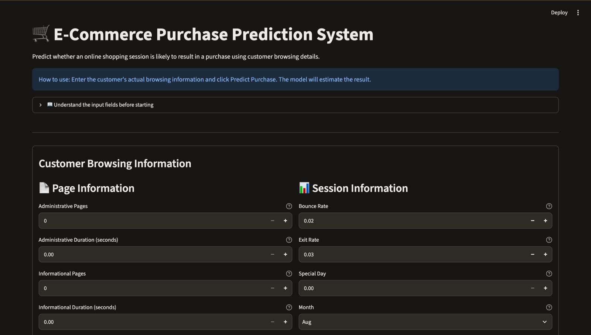
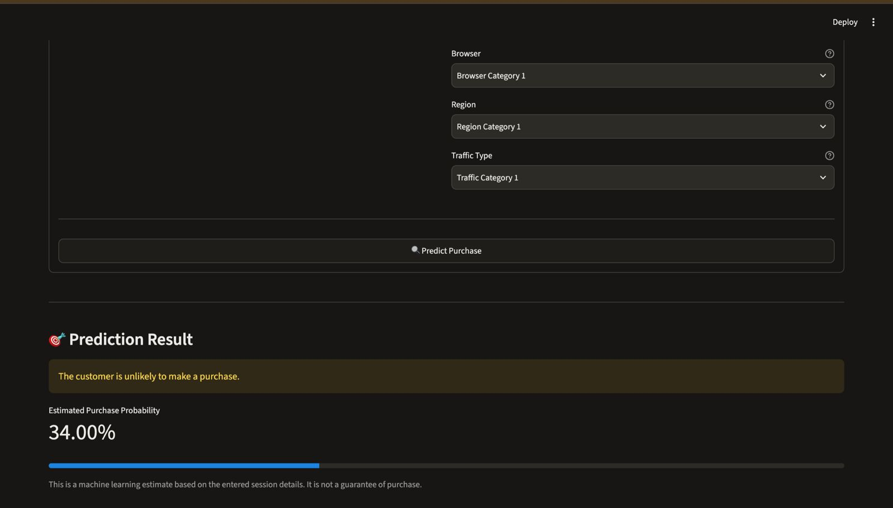

# 🛒 E-Commerce Purchase Prediction System

A Machine Learning project that predicts whether an online shopping session is likely to result in a purchase based on customer browsing behaviour.

## 📌 Project Overview

The E-Commerce Purchase Prediction System uses machine learning algorithms to analyse customer browsing activities and predict whether a shopping session will result in a purchase.

The system uses the Online Shoppers Purchasing Intention Dataset and compares multiple machine learning models. A Random Forest Classifier was selected as the final model and integrated into a Streamlit web application.

## 🎯 Project Objectives

- Analyse customer browsing behaviour.
- Clean and prepare the dataset.
- Perform Exploratory Data Analysis (EDA).
- Train and compare machine learning models.
- Predict purchase and non-purchase sessions.
- Display predictions through an interactive web application.

## 📊 Dataset Information

**Dataset:** Online Shoppers Purchasing Intention Dataset

**Source:** UCI Machine Learning Repository

**Dataset link:** https://archive.ics.uci.edu/dataset/468/online+shoppers+purchasing+intention+dataset

Dataset details:
- Original records: 12,330
- Duplicate records removed: 125
- Cleaned records: 12,205
- Input features: 17
- Target variable: Revenue

The target variable indicates whether a shopping session resulted in a purchase.

## 🛠️ Technologies Used

- Python
- Pandas
- NumPy
- Matplotlib
- Seaborn
- Scikit-learn
- Streamlit
- Joblib
- VS Code

## ⚙️ Project Workflow

1. Data Collection – Downloaded the dataset from the UCI Machine Learning Repository.
2. Data Cleaning – Checked missing values and removed duplicate records.
3. Exploratory Data Analysis – Analysed customer browsing patterns.
4. Data Preprocessing – Applied StandardScaler and OneHotEncoder.
5. Model Training – Trained Logistic Regression, KNN and Random Forest models.
6. Model Evaluation – Compared models using accuracy, precision, recall and F1-score.
7. Model Saving – Saved the selected Random Forest pipeline using Joblib.
8. Web Application – Developed an interactive prediction application using Streamlit.

## 🤖 Machine Learning Models

Three machine learning algorithms were trained and evaluated.

| Model | Accuracy |
|---|---:|
| Logistic Regression | 88.69% |
| K-Nearest Neighbors (KNN) | 87.34% |
| Random Forest | 89.59% |

**Selected Model:** Random Forest Classifier

The Random Forest model achieved the highest accuracy among the three models tested.

### Final Model Performance

- Accuracy: 89.59%
- Purchase Precision: 65%
- Purchase Recall: 72%
- Purchase F1-score: 68%

The dataset contains more non-purchase sessions than purchase sessions. Therefore, precision, recall and F1-score are also considered when evaluating the model.

## 🌐 Web Application Features

The Streamlit application allows users to:

- Enter customer browsing information.
- Select visitor and session details.
- Choose operating system, browser, region and traffic categories.
- Predict purchase or no-purchase outcomes.
- View estimated purchase probability.
- Understand input fields through help descriptions and tooltips.

## 📂 Project Structure

```text
Ecommerce-Purchase-Prediction/
│
├── dataset/
│   ├── online_shoppers_intention.csv
│   └── cleaned_online_shoppers.csv
│
├── models/
│   └── best_purchase_model.pkl
│
├── screenshots/
│
├── .venv/
│
├── data_exploration.py
├── data_cleaning.py
├── feature_analysis.py
├── data_preparation.py
├── model_preprocessing.py
├── logistic_regression.py
├── knn_model.py
├── random_forest.py
├── random_forest_tuning.py
├── save_best_model.py
├── test_saved_model.py
├── inspect_app_inputs.py
├── app.py
└── README.md
```

## 🚀 How to Run the Project

### 1. Clone the repository

```bash
git clone https://github.com/farzinmansoor/Ecommerce-Purchase-Prediction.git
```

### 2. Open the project folder

```bash
cd Ecommerce-Purchase-Prediction
```

### 3. Create a virtual environment

```bash
python3 -m venv .venv
```

### 4. Activate the virtual environment

For macOS:

```bash
source .venv/bin/activate
```

### 5. Install the required packages

```bash
pip install pandas numpy matplotlib seaborn scikit-learn streamlit joblib
```

### 6. Run the Streamlit application

```bash
streamlit run app.py
```

The application will open in your browser at:

```text
http://localhost:8501
```

**Note:** The dataset and saved model files must be available in their respective folders before running the application.

## 📸 Application Screenshots

Add your application screenshots to the `screenshots/` folder and include them here.

### Application Interface



### Prediction Result



## 📚 Dataset Reference

Sakar, C. O., & Kastro, Y. (2018). Online Shoppers Purchasing Intention Dataset. UCI Machine Learning Repository.

Dataset licence: CC BY 4.0.

## ⚠️ Disclaimer

The predictions are machine learning estimates based on historical shopping-session data. They do not guarantee whether an individual customer will make a purchase.

## 👨‍💻 Author

**Farzin Mansoor**

GitHub: https://github.com/farzinmansoor

LinkedIn: https://linkedin.com/in/farzin-mansoor-8045b3361/
